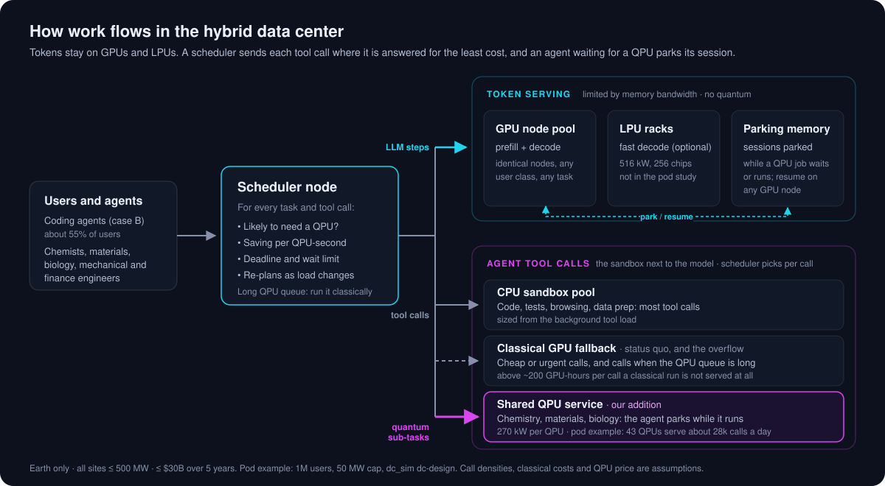
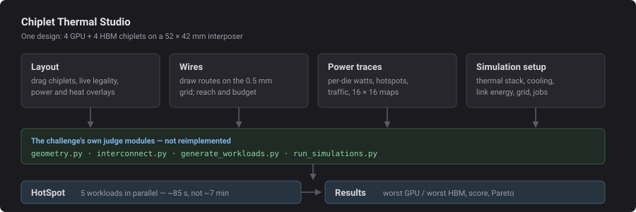

# quantum-data-center


Our entry for SUNDAI @ MIT Track 1, "Build the AI data center of 2035": serve 100% of one user case on Earth, inside 500 MW and $30B, then make it cheap.

**The problem we take on.** In 2035, 50M agent developers launch 1.5B background agent tasks a day. If just one in a million calls a high-accuracy chemistry tool, a GPU sandbox needs about 48k more GPUs (282 MW, $7.9B), which pushes the fleet over the 500 MW cap. Six QPUs do the same calls in 1.7 MW. We design the GPU + QPU data center and the router that sends each task to the right machine, to cut energy and cost per task. A QPU only pays off when the classical method is expensive: above about 55 GPU-hours per call on cost (about 4 on energy). We assume 768, and the page shows that break-even.



The team page lives in `web/`. It opens with the problem statement and the status quo for the three cases, followed by a section per workstream.

## Run the page

```bash
cd web
npm install
npm run dev      # http://localhost:5173
npm run build    # typecheck + static build into web/dist
```

Pushing to `main` deploys to GitHub Pages through `.github/workflows/pages.yml`. Turn it on once under Settings → Pages → Source: GitHub Actions.

## Add your work

- **Your workstream section:** edit `docs/workstreams/<name>.md`. The page renders it as-is.
- **Research notes:** `docs/research-notes.md`.
- **Fleet model numbers:** `web/src/model/brief.ts` holds every number from the brief, each tagged with its page. `web/src/model/fleet.ts` is the napkin model. Both are plain TypeScript that Node 24 runs directly, so a quick script can import `computeFleet` to try numbers.
- **Simulation output for the web** (thermal runs, sweeps): put JSON under `web/public/data/<workstream>/`.

The brief and deck live in `data/`, which isn't committed. Ask a teammate for the files.

---

# Chiplet Thermal Studio

A desktop workbench for the SUNDAI *Design the coolest chip* challenge: place four GPU
and four HBM chiplets on a 52 × 42 mm silicon interposer, route the eight
compulsory links by hand, edit the power traces, and run HotSpot over the
result.

Placement is continuous, every rule is checked live, and the two objectives —
worst GPU and worst HBM temperature — are tracked across every run of a
session.



## Why the numbers can be trusted

The GUI does not reimplement any of the physics. It imports the challenge's own
judge modules — `geometry.py`, `interconnect.py`, `generate_workloads.py` and
`run_simulations.py` — and drives the real HotSpot binary. Legality, port
assignment, link heat, the HotSpot input files and the peak-temperature
extraction are therefore identical to what the judge computes.

Running the bundled `random_layout.json` reproduces the reference objectives
exactly:

| Workload | GPU peak | HBM peak |
| --- | ---: | ---: |
| `tensor_training` | 102.21 °C | 87.05 °C |
| `skewed_compute` | **104.59 °C** | 81.97 °C |
| `attention_decode` | 86.01 °C | 79.73 °C |
| `memory_stream` | 96.89 °C | **97.68 °C** |
| `mixed_serving` | 94.23 °C | 83.77 °C |

→ worst GPU 104.59 °C, worst HBM 97.68 °C, leaderboard score 1.0000.

The five workloads are independent steady-state solves, so they run in
parallel: about **85 seconds instead of about 7 minutes** on a 32-core machine,
with identical results.

## Getting started

**Windows:** double-click `run_gui.bat`. On a fresh clone it finds a Python,
offers to install the three packages it needs into a local `.venv`, and starts
the GUI.

**Anywhere:**

```bash
python -m pip install -r requirements.txt
python -m chiplet_gui
```

Requires Python 3.10+ and PySide6, numpy and matplotlib.

### HotSpot

Simulating needs a compiled [HotSpot](https://github.com/uvahotspot/HotSpot).
The GUI auto-detects one in this folder, its parent, or a `HotSpot-master/`,
`HotSpot/` or `vendor/HotSpot/` subdirectory, and honours the `HOTSPOT_BINARY`
environment variable. The binary must stay inside its own repository checkout,
because `examples/example3/example.config` is read from next to it.

```bash
git clone https://github.com/uvahotspot/HotSpot.git ../vendor/HotSpot
git -C ../vendor/HotSpot checkout f18831e48cef5d62580585cca0d7fab6c71bc3cc
make -C ../vendor/HotSpot -j2
```

Without HotSpot everything else still works — placement, routing, validation,
power editing and all previews — and **Export HotSpot inputs** writes a
complete input set to simulate elsewhere.

## What it does

**Layout.** Drag chiplets with snapping and edge clamping; the layout is
re-validated in about 2 ms per move, so the verdict is always current and a die
that breaks a rule turns red with every violation named. Overlays draw die-plane
power, interposer wire and PHY power, combined W/mm², or HotSpot temperature.
Power previews take about 7 ms, so link heat visibly moves as a die is dragged.

**Wires.** Draw Manhattan routes on the 0.5 mm track grid by clicking
waypoints. Blocked cells are shaded, the required port-access cells are marked,
and the draft is checked against both the per-link reach and the
13,500 GB/s·mm budget shared by all eight links — a route that would fail is
refused before it is committed.

**Power traces.** Per-die watts, hotspot weights and link utilisations, with all
eight 16 × 16 maps redrawing live. Reads and writes `workloads.json`,
`agent_workloads.json`, `challenge_spec.json` and its own format; a workload can
also pin explicit maps so an externally measured trace keeps its exact numbers.

**Simulation setup.** Every number the judge reads is editable — thermal stack,
cooling, interconnect energy coefficients, port and routing rules — plus grid
size and parallelism. Deviations from `challenge_spec.json` are listed live and
recorded in each run, so it is always clear whether a score is still
leaderboard-comparable.

**Results.** Per-workload and per-die peaks with their power budget, and a
worst-GPU / worst-HBM Pareto scatter of every run in the session, with the
reference layout drawn as crosshairs.

A design saves to one JSON file carrying the layout, the wires, the power
traces and the whole setup together, so it travels as a unit.

Full documentation: **[README_GUI.md](README_GUI.md)**.

## Quantum architecture simulator

`quantum_arch/` extends the same idea to quantum computing hardware: qubit arrays of four
modalities next to cryogenic controllers, decoders, CPUs and GPUs, evaluated for computing power
(logical qubits, rQOPS), energy and the heat budget of the dilution-refrigerator stages. See
**[README_QUANTUM.md](README_QUANTUM.md)**.

## Repository layout

```
chiplet_gui/                  the GUI (this project)
  core/                       spec loading, project model, validation, runs
  gui/                        canvas, panels, theming
chiplet_thermal_continuous/   the challenge package, unmodified
quantum_arch/                 quantum-classical architecture simulator (see README_QUANTUM.md)
tests/                        tests for quantum_arch
run_gui.bat                   double-click launcher
requirements.txt
```

## Provenance and licensing

Two parts of this repository are **not** mine to license:

- `chiplet_thermal_continuous/` is the SUNDAI *Beat the Hotspot* challenge
  package, included unmodified so the GUI's results are reproducible. Check the
  challenge's own terms before republishing it.
- HotSpot is a separate project from the University of Virginia and is **not**
  bundled here; it is fetched and built separately.

No licence file is included for that reason. Add one covering `chiplet_gui/`
only once the status of the bundled package is clear to you.

## Caveats

These come from the challenge, not the GUI. The thermal model is a deliberately
simplified three-layer stack with a fixed cooler; the base powers, link traffic
and PHY/wire energy coefficients are synthetic benchmark assumptions rather than
measured GPU or HBM data; and the router models no wire width, congestion, IR
drop, latency or vias. Outputs are relative benchmark values, not calibrated
junction predictions.
