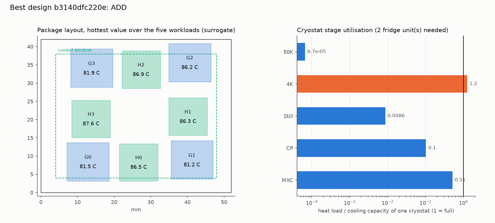
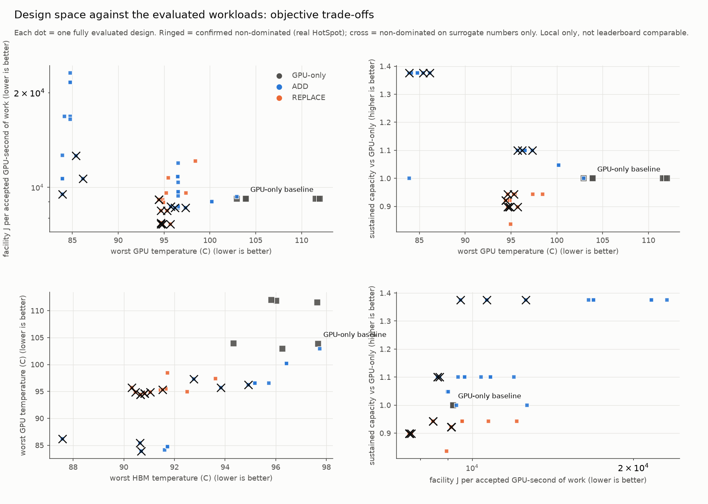
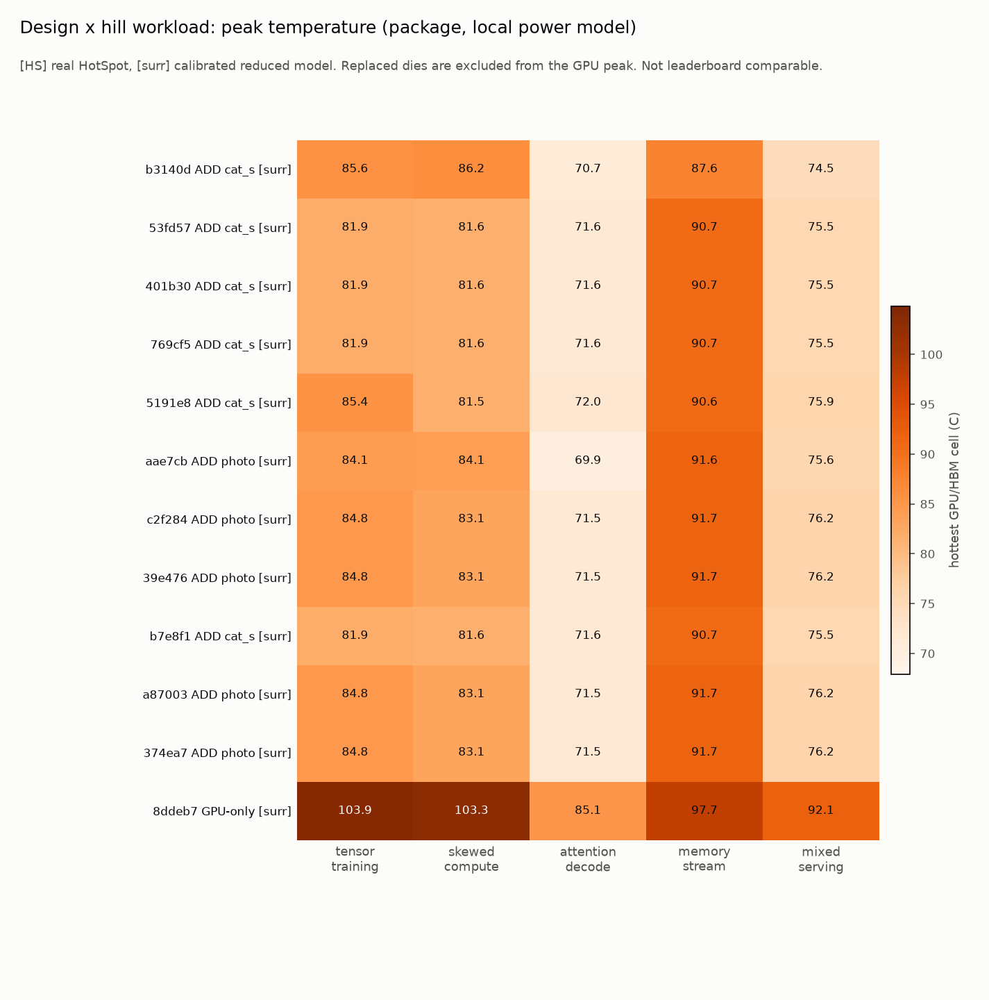
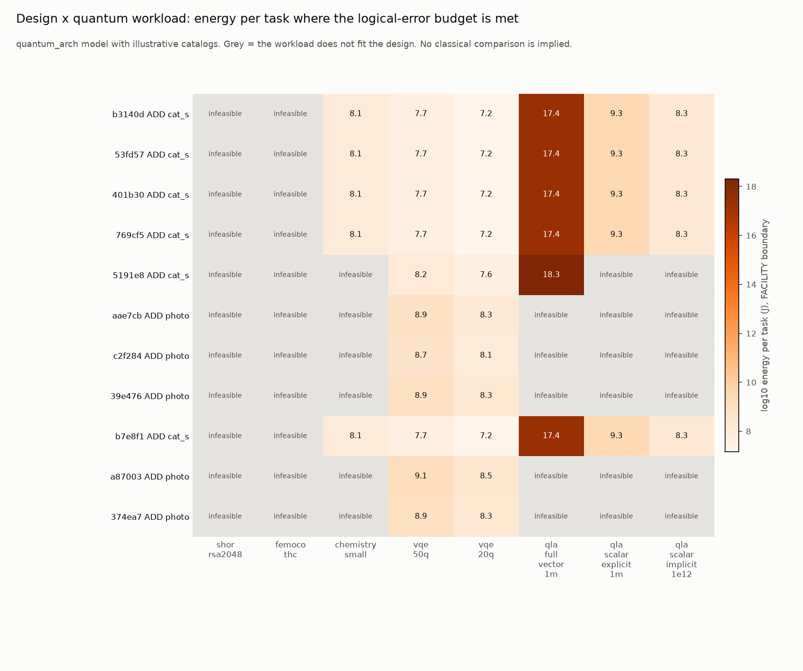
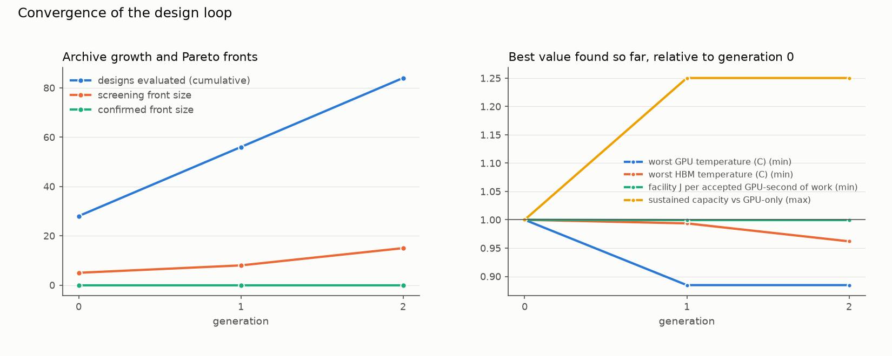

# Design loop report: example_2035

> **LOCAL-ONLY STUDY. Results use quantum hardware, illustrative catalogs and (for screening) a thermal surrogate; they are NOT comparable with, and must never be submitted to, the Beat the Hotspot leaderboard.**

`leaderboard_comparable: false`

Generated by `design_loop` 0.1.0. Seed 2035. Run directory `smoke_surrogate`.

## 1. What was evaluated, and by what

| view | evaluator / source |
|---|---|
| quantum_arch (error budget, rQOPS, cryostat, power) | model (illustrative catalogs, mid-2030s scenario profile) |
| layout legality | judge's own `validate_layout` (real) |
| package temperatures, screening | reduced thermal model fitted to HotSpot (calibrated) : SURROGATE, steers the search only |
| package temperatures, confirmation | NOT RUN in this run: no design is confirmed, so no claim below is backed by HotSpot |
| facility energy / capacity / break-even | `quantum_arch.datacenter` scheduler (model) |

Designs: 84 registered, 53 complete, 31 infeasible (hard constraint violated), 0 partial (excluded from fronts and rankings). Confirmed by real HotSpot: 0. HotSpot runs used: 0. Stop reason: generation limit.

## 2. Surrogate versus HotSpot

Calibration (15 real HotSpot runs of layouts / power scenarios): in-sample RMSE 2.02 C over 560 die peaks; leave-one-layout-out RMSE 2.08 C, MAE 1.73 C, worst error 5.51 C. For the headline metrics, leave-one-out MAE is 1.62 C (worst GPU, Spearman 0.82) and 1.37 C (worst HBM, Spearman 0.81). The model is only trusted near the calibrated layouts and power levels.

No design of this run has both a surrogate and a HotSpot result, so no in-run agreement could be measured.

## 3. Pareto fronts

Objectives: worst GPU temperature (C) (min), worst HBM temperature (C) (min), facility J per accepted GPU-second of work (min), sustained capacity vs GPU-only (max). Non-dominated sorting over designs that are complete (every evaluator answered for the full workload matrix) and satisfy all hard constraints; partial and infeasible designs cannot enter. Energy is at the FACILITY boundary; temperatures are package-level; capacity is relative to the GPU-only facility.

### 3.1 Confirmed front (real HotSpot thermal numbers; the only one that may support claims)

_empty: no design was confirmed by real HotSpot._

### 3.2 Screening front (surrogate thermal numbers; steers the search, NOT a claim)

| design | origin | mode | configuration | tier / thermal source | worst GPU temperature (C) [min] | worst HBM temperature (C) [min] | facility J per accepted GPU-second of work [min] | sustained capacity vs GPU-only [max] |
|---|---|---|---|---|---|---|---|---|
| `b3140dfc220e` | g2 layout_search | ADD | cat_superconducting / cryo_cmos_4k, 100,000 qubits, cat_repetition+repetition_matching on asic_rt@RT, task vqe_50q, f=0.30, 3 systems, cryostat x20 (non-baseline layout) | screened / surrogate | 86.15 | 87.58 | 1.06e+04 | 1.38 |
| `53fd575c8e6a` | g2 neighbour | ADD | cat_superconducting / cryo_cmos_4k, 100,000 qubits, cat_repetition+repetition_matching on asic_rt@RT, task vqe_50q, f=0.30, 2 systems, cryostat x20 (non-baseline layout) | screened / surrogate | 83.91 | 90.68 | 9510.02 | 1.38 |
| `5191e83bcd1b` | g2 mutate | ADD | cat_superconducting / cryo_cmos_4k, 100,000 qubits, cat_repetition+repetition_matching on asic_rt@RT, task vqe_50q, f=0.30, 3 systems, cryostat x20 (non-baseline layout) | screened / surrogate | 85.40 | 90.65 | 1.26e+04 | 1.38 |
| `e74e6b418783` | g1 crossover | REPLACE | superconducting / cryo_cmos_4k, 20,000 qubits, surface+union_find on asic_4k@4K, task vqe_50q, f=0.30, 2 systems, cryostat x20, support dies G3 | screened / surrogate | 94.64 | 90.82 | 8443.45 | 0.94 |
| `fbaae8a11117` | g1 layout_search | REPLACE | neutral_atom / ambient, 100,000 qubits, surface+union_find on asic_rt@package, task vqe_50q, f=0.30, 2 systems, cryostat x1, support dies G3 (non-baseline layout) | screened / surrogate | 94.84 | 90.47 | 7632.63 | 0.90 |
| `9e5954bb3150` | g2 layout_search | ADD | neutral_atom / ambient, 40,000 qubits, surface+union_find on asic_rt@RT, task vqe_50q, f=0.10, 2 systems, cryostat x1 (non-baseline layout) | screened / surrogate | 97.33 | 92.76 | 8618.61 | 1.10 |
| `5a52d76ef8c9` | g2 layout_search | REPLACE | neutral_atom / ambient, 100,000 qubits, surface+union_find on asic_rt@package, task vqe_50q, f=0.30, 2 systems, cryostat x1, support dies G3 (non-baseline layout) | screened / surrogate | 95.70 | 90.31 | 7628.91 | 0.90 |
| `b4f6d3111316` | g1 neighbour | REPLACE | neutral_atom / ambient, 100,000 qubits, surface+union_find on asic_rt@RT, task vqe_50q, f=0.30, 2 systems, cryostat x1, support dies G3 | screened / surrogate | 94.64 | 90.82 | 7632.63 | 0.90 |
| `dea4d56e1372` | g2 mutate | REPLACE | neutral_atom / ambient, 100,000 qubits, surface+union_find on asic_rt@RT, task vqe_50q, f=0.25, 2 systems, cryostat x1, support dies G3 | screened / surrogate | 94.64 | 90.82 | 7697.46 | 0.90 |
| `4c803ad7ed11` | g2 mutate | REPLACE | trapped_ion / ambient, 100,000 qubits, surface+union_find on asic_rt@package, task vqe_50q, f=0.30, 2 systems, cryostat x1, support dies G3 (non-baseline layout) | screened / surrogate | 94.41 | 90.65 | 9133.62 | 0.92 |
| `858073a32d68` | g1 layout_search | REPLACE | trapped_ion / ambient, 100,000 qubits, surface+union_find on asic_rt@package, task vqe_50q, f=0.30, 2 systems, cryostat x1, support dies G3 (non-baseline layout) | screened / surrogate | 94.41 | 90.65 | 9146.26 | 0.92 |
| `c28873385638` | g1 layout_search | ADD | neutral_atom / ambient, 100,000 qubits, surface+union_find on asic_rt@RT, task vqe_50q, f=0.10, 2 systems, cryostat x1 (non-baseline layout) | screened / surrogate | 95.73 | 93.83 | 8685.15 | 1.10 |
| `7a16f87a1c22` | g1 neighbour | REPLACE | neutral_atom / ambient, 100,000 qubits, surface+union_find on asic_rt@package, task vqe_50q, f=0.30, 2 systems, cryostat x1, support dies G3 | screened / surrogate | 94.85 | 91.04 | 7628.91 | 0.90 |
| `d1c0ccaa72be` | g2 crossover | REPLACE | superconducting / cryo_cmos_4k, 20,000 qubits, surface+union_find on asic_rt@package, task vqe_50q, f=0.30, 2 systems, cryostat x20, support dies G3 | screened / surrogate | 95.33 | 91.53 | 8442.55 | 0.94 |
| `318415928482` | g2 crossover | ADD | neutral_atom / ambient, 40,000 qubits, surface+union_find on asic_rt@RT, task vqe_50q, f=0.10, 2 systems, cryostat x1 (non-baseline layout) | screened / surrogate | 96.20 | 94.91 | 8618.61 | 1.10 |

### 3.3 Scalarised ranking

Weights {'worst_gpu_c': 1.0, 'worst_hbm_c': 1.0, 'energy_j_per_work': 1.0, 'capacity_rel': 1.0}; min-max normalised over the eligible set (0 = best on every objective).

No confirmed design: ranking on SCREENED (surrogate) numbers, not a claim.

| rank | design | score | mode | configuration |
|---|---|---|---|---|
| 1 | `b3140dfc220e` | 0.069 | ADD | cat_superconducting / cryo_cmos_4k, 100,000 qubits, cat_repetition+repetition_matching on asic_rt@RT, task vqe_50q, f=0.30, 3 systems, cryostat x20 |
| 2 | `53fd575c8e6a` | 0.107 | ADD | cat_superconducting / cryo_cmos_4k, 100,000 qubits, cat_repetition+repetition_matching on asic_rt@RT, task vqe_50q, f=0.30, 2 systems, cryostat x20 |
| 3 | `401b30d6c95c` | 0.125 | ADD | cat_superconducting / cryo_cmos_4k, 100,000 qubits, cat_repetition+repetition_matching on asic_rt@RT, task vqe_20q, f=0.30, 3 systems, cryostat x20 |
| 4 | `769cf59013db` | 0.125 | ADD | cat_superconducting / cryo_cmos_4k, 100,000 qubits, cat_repetition+repetition_matching on asic_rt@RT, task vqe_50q, f=0.30, 3 systems, cryostat x20 |
| 5 | `5191e83bcd1b` | 0.169 | ADD | cat_superconducting / cryo_cmos_4k, 100,000 qubits, cat_repetition+repetition_matching on asic_rt@RT, task vqe_50q, f=0.30, 3 systems, cryostat x20 |
| 6 | `aae7cb2e6e34` | 0.250 | ADD | photonic / fbqc_snspd, 1,100 qubits, fusion_network+fusion_matching on fpga@RT, task vqe_20q, f=0.30, 4 systems, cryostat x140 |
| 7 | `c2f284c83646` | 0.253 | ADD | photonic / fbqc_snspd, 1,100 qubits, fusion_network+fusion_matching on fpga@RT, task vqe_20q, f=0.30, 4 systems, cryostat x140 |
| 8 | `39e47634eb41` | 0.259 | ADD | photonic / fbqc_snspd, 1,100 qubits, fusion_network+fusion_matching on fpga@RT, task vqe_20q, f=0.30, 4 systems, cryostat x140 |

## 4. Designs in detail

Best ranked overall: `b3140dfc220e` (ADD). 

### Best quantum-hybrid design

### Design `b3140dfc220e` (ADD), tier screened

Configuration: cat_superconducting / cryo_cmos_4k, 100,000 qubits, cat_repetition+repetition_matching on asic_rt@RT, task vqe_50q, f=0.30, 3 systems, cryostat x20.

Provenance: generation 2, operator `layout_search`, parents `769cf59013db`, changed ['layout (surrogate score 0.8610, 31 evals)'].

**Package thermal (surrogate, 64x64 mesh, boundary: package)**

| workload | GPU peak C | HBM peak C | support peak C | package W |
|---|---|---|---|---|
| tensor_training | 85.58 | 66.77 | n/a | 296.0 |
| skewed_compute | 86.15 | 62.59 | n/a | 256.1 |
| attention_decode | 70.74 | 67.72 | n/a | 258.9 |
| memory_stream | 81.94 | 87.58 | n/a | 341.0 |
| mixed_serving | 74.53 | 68.12 | n/a | 271.2 |

Informational score vs the published 64-mesh baseline reference: 0.861 (NOT leaderboard comparable).

**Quantum subsystem (quantum_arch model)**

| quantity | value | boundary |
|---|---|---|
| task / feasible | vqe_50q / True |  |
| task runtime | 41.1 s |  |
| task energy | 4.28e+07 J | system |
| task energy | 4.93e+07 J | facility |
| logical qubits / code distance / rQOPS | 660 / 27 / 2.11e+07 |  |
| decoder devices (keeps up) | 1 x asic_decoder_rt_2035 (True) |  |
| power, QPU module (electrical) | 149 W | module |
| power, whole quantum computer | 1.05 MW | system |
| power incl. PUE | 1.21 MW | facility |
| fridge units / lines-limited units | 2 / 1 |  |
| quantum workloads feasible | 6 of 8 |  |

Cryostat stage load / capacity: 50K 6.7e-05x; 4K 1.2x (overloaded); Still 0.0086x; CP 0.1x; MXC 0.51x

**Data centre (quantum_arch.datacenter scheduler, boundary: facility)**

| quantity | value |
|---|---|
| facility J per accepted GPU-second of work | 1.06e+04 |
| ... GPU-only | 9202.6 |
| energy ratio vs GPU-only | 1.157 |
| capacity vs GPU-only (max sustainable demand) | 1.375 |
| ordinary-AI capacity ratio | 1.379 |
| movable share of demand (INPUT) | 0.300 |
| break-even movable share, energy / capacity | 0.520 / 0.000 |
| facility power | 11.9 MW |

| job class | demand share | routed to quantum | J per accepted answer (facility) | note |
|---|---|---|---|---|
| movable_task (movable) | 0.30 | 1.000 | 3.38e+10 |  |
| llm_serving | 0.27 | 0.000 | 38.0 |  |
| llm_training | 0.23 | 0.000 | 6.31e+11 |  |
| engineering_simulation | 0.12 | 0.000 | 4.39e+09 |  |
| movable_task | 0.08 | 0.000 | 2.63e+10 |  |

**Sensitivity to the classical cost of the movable job class (INPUT assumption; facility boundary)**

| classical cost of the movable job (x config value) | energy ratio vs GPU-only | capacity vs GPU-only | served demand |
|---|---|---|---|
| x0.1 (77 GPU-module-hours per job) | 1.157 | 1.375 | 1.000 |
| x0.3 (230 GPU-module-hours per job) | 1.157 | 1.375 | 1.000 |
| x1 (768 GPU-module-hours per job) | 1.157 | 1.375 | 1.000 |
| x3 (2,304 GPU-module-hours per job) | 1.157 | 1.375 | 1.000 |
| x10 (7,680 GPU-module-hours per job) | 1.157 | 1.375 | 1.000 |

No classical cost within x0.01 to x100 of the configured value gives both energy parity and the required served demand.

### Reference: GPU-only baseline

### Design `8ddeb7d77855` (GPU-only), tier screened

Configuration: 4 GPU + 4 HBM, no quantum.

Provenance: generation 0, operator `seed:gpu_only`, parents none, changed [].

**Package thermal (surrogate, 64x64 mesh, boundary: package)**

| workload | GPU peak C | HBM peak C | support peak C | package W |
|---|---|---|---|---|
| tensor_training | 103.86 | 84.56 | n/a | 402.7 |
| skewed_compute | 103.25 | 78.83 | n/a | 345.4 |
| attention_decode | 85.05 | 77.71 | n/a | 321.7 |
| memory_stream | 96.09 | 97.68 | n/a | 393.0 |
| mixed_serving | 92.15 | 79.85 | n/a | 350.4 |

Informational score vs the published 64-mesh baseline reference: 1.000 (NOT leaderboard comparable).

**Data centre (quantum_arch.datacenter scheduler, boundary: facility)**

| quantity | value |
|---|---|
| facility J per accepted GPU-second of work | 9202.6 |
| ... GPU-only | n/a |
| energy ratio vs GPU-only | 1.000 |
| capacity vs GPU-only (max sustainable demand) | 1.000 |
| ordinary-AI capacity ratio | 1.000 |
| movable share of demand (INPUT) | 0.000 |
| break-even movable share, energy / capacity | n/a / n/a |
| facility power | 10.3 MW |

| job class | demand share | routed to quantum | J per accepted answer (facility) | note |
|---|---|---|---|---|
| movable_task (movable) | 1e-06 | 0.000 | 2.46e+10 | no quantum system of this kind in the scenario |
| llm_serving | 0.39 | 0.000 | 35.4 |  |
| llm_training | 0.33 | 0.000 | 5.9e+11 |  |
| engineering_simulation | 0.17 | 0.000 | 4.09e+09 |  |
| movable_task | 0.11 | 0.000 | 2.46e+10 |  |

## 5. Findings (what these models say, not predictions)

Most common hard-constraint violations among the infeasible designs: quantum task vqe_50q not feasible (5); serves only 70% of the baseline demand (5); control lines exceed one cryostat (4); quantum task qla_full_vector_1m not feasible (4); quantum task shor_rsa2048 not feasible (4).
Eligible designs per mode: GPU-only 6, ADD 29, REPLACE 18.
ADD: best worst-GPU temperature 83.91 C (GPU-only 103.86), best HBM 87.58 C (GPU-only 97.68), lowest facility energy per work 8619 J/GPU-s (GPU-only 9203), highest capacity 1.375x. Temperature numbers are from the surrogate where marked in the tables.
REPLACE: best worst-GPU temperature 94.41 C (GPU-only 103.86), best HBM 90.31 C (GPU-only 97.68), lowest facility energy per work 7629 J/GPU-s (GPU-only 9203), highest capacity 0.943x. Temperature numbers are from the surrogate where marked in the tables.
The screening front has 15 member(s) spanning: ADD, REPLACE.
Design `b4f6d3111316` reaches energy parity with GPU-only at a movable share of 0.00 (input assumption scale).

All of this is conditional on the declared inputs (offload share, classical cost of the movable job class, mapping quality) and the illustrative catalogs; the loop explores a model, it does not establish that any quantum system helps.

## 6. Figures

Full design x workload matrix: `matrix.json` (hill workloads with per-die peaks, all quantum workloads, data-centre job classes, GPU baseline workloads) and `designs.csv`.

## 7. Limits

- The offload fraction, the number of quantum systems, the classical cost of the movable job class, mapping quality and all catalog parameters are INPUT assumptions. Nothing here is derived from, or evidence of, a quantum speedup or advantage.
- `quantum_arch` is an illustrative resource model with a mid-2030s scenario profile; it is not a forecast.
- The package model (about 350 W synthetic packages) and the facility model (5 kW accelerator modules) live at different scales and are linked only through the design's genes (offload share, replaced dies, quantum architecture).
- HotSpot confirmation uses the judge's pipeline on a 64 mesh; hybrid power maps use the LOCAL variant's `judge_modified`. Support-chiplet junction temperature limits and decoders-per-die are assumptions.
- Surrogate numbers are labelled everywhere; only real-HotSpot numbers are eligible for the confirmed front.
- LOCAL ONLY. Results use quantum hardware and must never be compared with or submitted to the Beat the Hotspot leaderboard.
